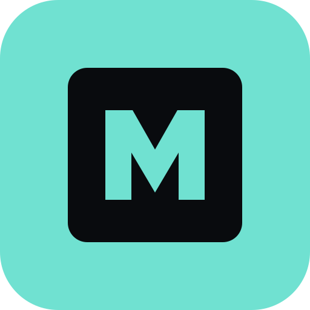

#  Blockboard

**A calm, screenshot-first assignment planner for seeing the work and finishing it.**

<div align="center">

[](https://abdnnur333.github.io/blockboard/)
[](#pwa-installation)
[](#project-structure)

**[Open Blockboard](https://abdnnur333.github.io/blockboard/)** · **[Report an issue](https://github.com/abdnnur333/blockboard/issues)** · **[View source](https://github.com/abdnnur333/blockboard)**

</div>

---

## Why Blockboard?

Blockboard turns assignments into manageable blocks with deadlines, preparation days, notes, marks, and proof screenshots. It keeps your entire queue visible, highlights approaching deadlines, and helps you start the next task without losing momentum.

## Features

- **Quick add** - Capture a task in seconds and choose a deadline of tomorrow, 3 days, 1 week, or 2 weeks.
- **Visual assignment blocks** - Organize courses, assessment types, notes, dates, times, marks, and proof images.
- **Plan calendar** - See booked study days, deadlines, and overdue items at a glance.
- **Deadline intelligence** - Automatically labels blocks as overdue, due within 24 hours, or on track.
- **Screenshot proof** - Paste from the clipboard, drag and drop an image, or browse for a proof screenshot.
- **Powerful search** - Find assignments across titles, courses, types, notes, and deadlines, including minor typos.
- **Drag-and-drop ordering** - Reorder your queue manually or sort it by deadline.
- **Focus tools** - Run a Pomodoro timer, enter focus mode, or float a deadline widget on screen.
- **Daily check-in** - Start each day with a quick prompt for upcoming work.
- **Local-first storage** - Your assignments save in the browser without an account.
- **Optional cloud sync** - Sign in with a student ID to synchronize data and retain version history.
- **Backups and restore** - Export JSON, import data, choose a backup folder, or compare two backups.
- **Installable PWA** - Use Blockboard as an app on desktop or mobile.
- **Offline support** - Cached app files keep the planner available after the first visit.

## Screenshots

> Add screenshots of the dashboard, calendar, and proof workflow to this section for a visual product tour.

## Quick Start

No build step or package installation is required.

### Open locally

```bash
cd blockboard
python -m http.server 4173
```

Then visit `http://localhost:4173`.

### Windows app launcher

Double-click [`Start Blockboard.vbs`](Start%20Blockboard.vbs). The launcher starts a local server on port `4173` and opens Blockboard in Chrome app mode.

To start a different way, open `index.html` through a local web server. Opening it directly with a `file://` URL may limit PWA and browser APIs.

## Data and Privacy

Blockboard stores the planner locally in `localStorage` under `blockboard.planner.v4`.

- Local data remains on the current browser and device unless cloud sync or backup is enabled.
- Exported backups use JSON and can be imported later.
- Cloud sync is optional and is designed around the student-ID flow included in the app.
- Screenshots are stored as image data; keep this in mind when creating or comparing large backups.

## Backup and Restore

Open **Data & backup** in the top-right menu:

1. **Export backup** downloads or saves a complete JSON backup.
2. **Choose backup folder** lets supported browsers save future backups directly to a selected folder.
3. **Import data** adds saved assignments and settings.
4. **Compare JSON** shows deleted, added, and changed blocks between a backup and your current data.
5. **Version history** restores earlier cloud snapshots where that feature is connected.

## Cloud Sync Setup

Cloud sync is optional. The app can run fully with browser-local storage.

To enable or configure the included Supabase integration:

1. Create a Supabase project.
2. Run [`supabase-setup.sql`](supabase-setup.sql) in the Supabase SQL editor.
3. Update the Supabase URL and publishable key in `index.html` if you are using a different project.
4. Provide the additional `blockboard_push_subscriptions` table and notification backend if push alerts are required.

The SQL creates:

- `public.blockboard_data` - the latest planner payload
- `public.blockboard_versions` - retained cloud version snapshots
- Row-level security policies for owner-specific access

## PWA Installation

Blockboard includes:

- [`manifest.webmanifest`](manifest.webmanifest) for install metadata
- [`sw.js`](sw.js) for caching and offline navigation
- [`icon.svg`](icon.svg) as the app icon

Serve the project over HTTP or HTTPS, open it in a compatible browser, and use **Install app** or **Add to Home Screen**.

## Project Structure

```text
blockboard/
├── index.html              # Application UI and client-side behavior
├── icon.svg                # PWA icon
├── manifest.webmanifest    # Installable app metadata
├── sw.js                   # Service worker and offline cache
├── supabase-setup.sql      # Optional cloud database setup
├── Start Blockboard.vbs    # Windows Chrome app launcher
└── README.md
```

## Browser Support

Core planning and local storage work in modern browsers. Full support for these features depends on browser capabilities:

- Direct backup-folder access
- Document Picture-in-Picture
- Push notifications
- PWA installation

Chrome and Edge offer the broadest feature support.

## Contributing

1. Fork the repository.
2. Create a focused feature branch.
3. Make and test your changes locally.
4. Open a pull request with a clear description and screenshots for UI changes.

## License

No license file is currently included. All rights remain with the project owner unless a license is added.
